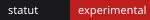
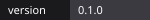
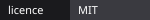
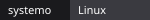

# Claude Desktop Rojo y Negro

<p align="center"></p>

<p align="center">
     
</p>

<p align="center"><a href="../../README.md">Esperanto</a> · <a href="README.fr.md">Français</a> · <a href="README.en.md">English</a> · <a href="README.es.md">Español</a></p>

Tema rojo y negro con símbolos libertarios para la aplicación Claude Desktop.
Sin afiliación con Anthropic, sin rastreo, sin peticiones externas.

## Inicio rápido

```bash
git clone https://github.com/AnARCHIS12/claude-desktop-rouge-noir.git && cd claude-desktop-rouge-noir && ./scripts/install.sh
```

Después cierre Claude Desktop por completo y ábralo de nuevo desde el menú de aplicaciones (no desde una terminal).

## Funciones

| Función | Descripción |
| --- | --- |
| Fondo negro | Página, barra lateral y paneles en negro profundo |
| Acentos rojos | Botones, selección, cursor, barras de desplazamiento (`#be1e1e`) |
| Franja diagonal | Diagonal roja y negra en la parte superior de la ventana |
| A circulada | A circulada discreta abajo a la derecha |
| Desinstalación | `./scripts/uninstall.sh` restablece el aspecto original |

## Compatibilidad

| Sistema | Estado |
| --- | --- |
| Linux (Fedora, COSMIC) | Instalación probada, resultado visual aún sin confirmar |
| Windows, macOS | No admitido por este script |

> Método no oficial: usa la ranura de extensión de React DevTools y la variable `REACT_PROFILE=1`. Una actualización de Claude Desktop puede romperlo.

## Funcionamiento

`scripts/install.sh` copia `extension/` en `~/.config/Claude/extensions/<id>/` y crea un lanzador de usuario `~/.local/share/applications/com.anthropic.Claude.desktop` que inicia la aplicación con `REACT_PROFILE=1`. La extensión inyecta CSS que redefine las variables de color `--cds-*`.

## Estructura

```text
extension/   manifest.json, theme.js (CSS inyectado)
scripts/     install.sh, uninstall.sh
docs/        traducciones e imágenes
```

## Contribuir

Vea [CONTRIBUTING.md](../../CONTRIBUTING.md).

## Licencia

MIT, vea [LICENSE](../../LICENSE).
