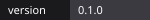
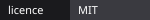
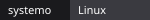

# Claude Desktop Rouge et Noir

<p align="center"></p>

<p align="center">
     
</p>

<p align="center"><a href="../../README.md">Esperanto</a> · <a href="README.fr.md">Français</a> · <a href="README.en.md">English</a> · <a href="README.es.md">Español</a></p>

Thème rouge et noir aux symboles libertaires pour l'application Claude Desktop.
Non affilié à Anthropic, sans pistage, sans requête externe.

## Démarrage rapide

```bash
git clone https://github.com/AnARCHIS12/claude-desktop-rouge-noir.git && cd claude-desktop-rouge-noir && ./scripts/install.sh
```

Fermez ensuite Claude Desktop complètement, puis relancez-le depuis le menu des applications (pas depuis un terminal).

## Fonctionnalités

| Fonctionnalité | Description |
| --- | --- |
| Fond noir | Page, barre latérale et panneaux en noir profond |
| Accents rouges | Boutons, sélection, curseur, barres de défilement (`#be1e1e`) |
| Liseré diagonal | Diagonale rouge et noir en haut de la fenêtre |
| A cerclé | A cerclé discret en bas à droite |
| Retrait | `./scripts/uninstall.sh` rétablit l'apparence d'origine |

## Compatibilité

| Système | État |
| --- | --- |
| Linux (Fedora, COSMIC) | Installation essayée, rendu pas encore confirmé |
| Windows, macOS | Non pris en charge par ce script |

> Méthode non officielle : elle utilise l'emplacement d'extension de React DevTools et la variable `REACT_PROFILE=1`. Une mise à jour de Claude Desktop peut la casser.

## Fonctionnement

`scripts/install.sh` copie `extension/` dans `~/.config/Claude/extensions/<id>/` et crée un lanceur utilisateur `~/.local/share/applications/com.anthropic.Claude.desktop` qui démarre l'application avec `REACT_PROFILE=1`. L'extension injecte un CSS qui redéfinit les variables de couleur `--cds-*`.

## Arborescence

```text
extension/   manifest.json, theme.js (CSS injecté)
scripts/     install.sh, uninstall.sh
docs/        traductions et images
```

## Contribuer

Voir [CONTRIBUTING.md](../../CONTRIBUTING.md).

## Licence

MIT, voir [LICENSE](../../LICENSE).
